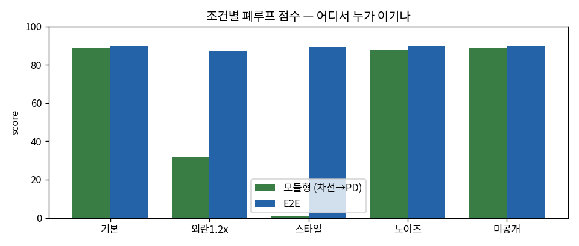
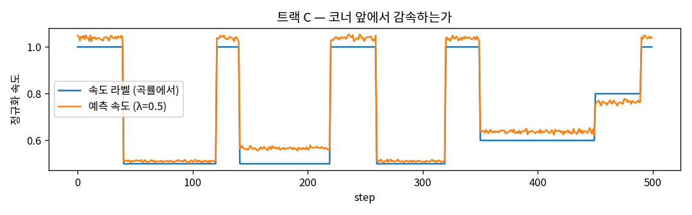
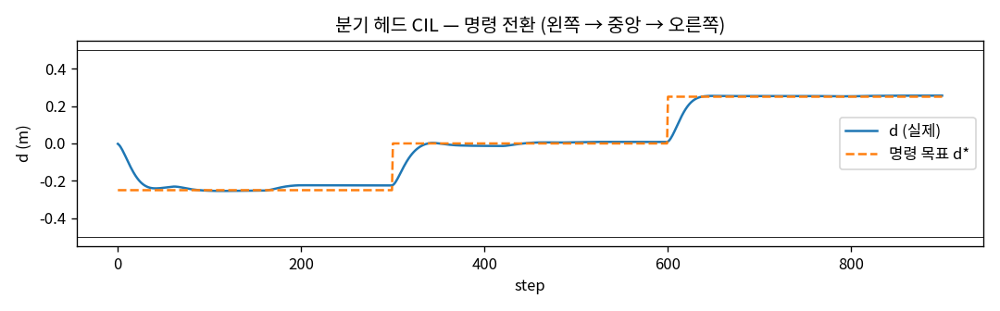

# 비교 리포트 — 202212305_김태윤 (8주차)

## 표 1. 정책 × 조건 폐루프 score (공개 A/B/C 및 미공개 트랙, 시드 0)
| 정책 | 기본 | 외란1.2x | 스타일 | 노이즈 | 미공개 |
|---|---|---|---|---|---|
| modular | 88.4 | 32.0 | 0.9 | 87.5 | 88.5 |
| e2e | 89.5 | 87.1 | 89.2 | 89.6 | 89.5 |
| multitask λ=0.5 | 89.3 |  |  |  |  |
| frame-stack | 88.9 |  |  |  |  |

## 그래프 1

## 해석 (5줄)
1. 어디서 누가 이겼나: E2E는 다섯 평가 조건 모두에서 모듈형보다 높은 점수를 기록했다. 특히 외란 조건에서는 87.1 대 32.0, 스타일 변경에서는 89.2 대 0.9로 큰 차이를 보여, 이번 실험에서 E2E가 환경 변화에 더 안정적이었다.

2. 왜 (구조로 설명): 모듈형은 미리 정한 도로색으로 마스크를 만들기 때문에 노면 색이 달라지면 도로 인식이 실패하고, 이후 위치·방향 추정과 PD 제어도 함께 영향을 받는다. E2E는 이미지에서 조향을 직접 예측하며, 이번 평가에서는 외란과 스타일 변화에도 높은 점수를 유지했다.

3. 예상과 다른 칸: 모듈형은 상태 추정이 유지되면 외란 이후에도 복구할 것으로 예상했지만, 외란 1.2배에서 점수가 32.0으로 크게 떨어졌다. 이는 모듈형도 상태 추정과 제어의 적용 범위에 한계가 있음을 보여주며, 구체적인 실패 원인은 추가 확인이 필요하다.

4. 내 챌린지 정책에 가져갈 것: 기본 정책은 E2E를 사용하겠다. 멀티태스크 λ=0.5와 프레임 스택은 기본 점수가 각각 89.3과 88.9로 E2E의 89.5보다 낮았으므로, 바로 적용하기보다 추가 검증하겠다. 시간 정보 실험에서 조향 진동을 줄인 출력 필터를 우선 개선 후보로 삼겠다.

5. 다음 실험: E2E에 출력 필터 α=0.7을 적용한 정책을 다섯 조건에서 시드 0~4로 평가하겠다. 기존 E2E와 평균 점수·표준편차·조향 진동을 비교하여, 기본 조건에서 관찰한 개선이 다른 환경에서도 유지되는지 확인하겠다.

## 추가 그래프

### 속도 예측 프로파일

### CIL 명령 전환 주행

