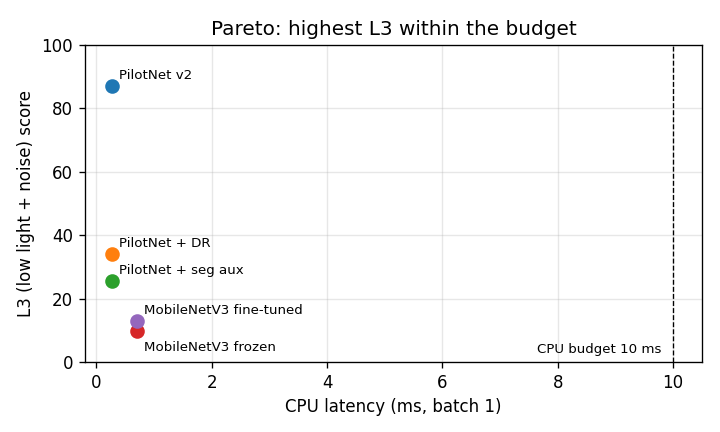
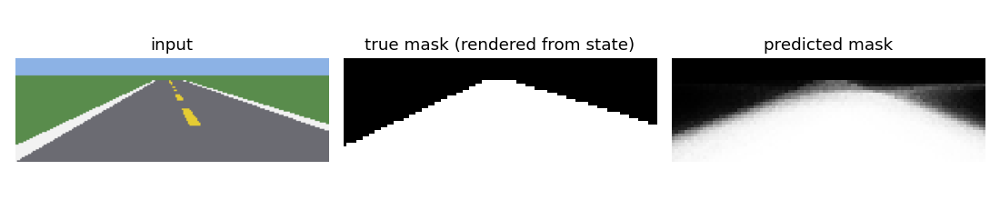

# 11주차 — 백본 전이와 합성 데이터

202212305 김태윤 · 2026-11-11

도메인 랜덤화, MobileNetV3-small의 동결·미세조정, 세그멘테이션 보조 학습을 비교했습니다.
세그 보조의 이미지·마스크 불일치를 수정하고, 수정 전후 대조군을 포함해 노트북의 모든 코드 셀을 재실행했습니다.

## 제출 파일

- [실행 노트북](Week11_demo.ipynb)
- [모델 선택 표](model_selection.csv) · [파레토 그림](pareto.png)
- [해석 5줄](백본실험리포트_202212305_김태윤.md)
- [최종 정책](my_policy_v3.onnx)
- [세그 수정 전후 비교](seg_fix_comparison.csv) · [마스크 예측 그림](seg_aux.png)
- [실행 조건](run_info.json) · [ONNX 검증 결과](verification.json)

## 모델 비교

공개 트랙 A/B/C, 평가 시드 0, L3 스타일 시드 7에서 측정했습니다.
점수는 완주율·도로 이탈·중앙 편차를 반영한 폐루프 주행 점수이며 정확도(%)가 아닙니다.
CPU 지연은 ONNX Runtime CPU, 배치 1, 워밍업 1회 후 이미지 200장의 전처리와 추론 시간을 포함한 평균입니다.
파라미터 수와 ONNX 크기는 배포 경로 기준이며, 세그 모델의 마스크 헤드는 배포에서 제외합니다.

| 모델 | 파라미터 | CPU 지연(ms) | ONNX(KiB) | L1 | L3 | L2 |
|---|---:|---:|---:|---:|---:|---:|
| PilotNet v2 | 252,219 | 0.28 | 988 | 89.5 | 87.0 | 82.6 |
| PilotNet + 랜덤화 | 252,219 | 0.28 | 988 | 89.2 | 34.1 | 10.6 |
| PilotNet + 세그 보조 | 246,749 | 0.28 | 966 | 29.8 | 25.6 | 10.6 |
| MobileNetV3 동결 | 984,809 | 0.71 | 3856 | 87.4 | 9.7 | 9.3 |
| MobileNetV3 미세조정 | 984,809 | 0.71 | 3856 | 57.0 | 12.9 | 7.4 |

선택 기준은 **CPU 지연 10ms 미만 → L3 내림차순 → 동점이면 L2 내림차순**입니다.
선택된 모델은 **PilotNet v2**이며 `my_policy_v3.onnx`에 저장했습니다.
파일명의 v3는 최종 산출물 이름이며 모델 구조가 반드시 바뀌었다는 뜻은 아닙니다.

## 세그 보조 수정 전후

기존 코드는 `make_augment(shift=False)`로 이미지만 좌우 반전하고 조향 부호를 바꾸지만,
상태에서 생성한 정답 마스크는 반전하지 않았습니다.
기본 학습을 `flip=False, shift=False`로 수정했고, `flip=True` 대조군도 별도로 다시 학습했습니다.

| 조건 | L1 | L3 | L2 | 검증 마스크 IoU |
|---|---:|---:|---:|---:|
| 수정 전: 이미지 반전·마스크 유지 | 88.5 | 25.5 | 10.6 | 0.757 |
| 수정 후: 좌우 반전 끔 | 29.8 | 25.6 | 10.6 | 0.876 |

두 조건은 같은 v2 특징 가중치, 학습 표본, 데이터 분할, 시드 0, 3에폭, 학습률 3e-4를 사용했습니다.
반전 증강 자체와 증강 난수 소비도 달라지므로, 이 비교가 마스크 정렬 효과만을 분리하지는 않습니다.
세그 보조는 v2의 특징 추출기를 복사하지만 조향 헤드는 새로 초기화합니다.
따라서 v2와의 차이를 보조 손실 하나의 효과로만 해석할 수 없습니다.

## 해석 5줄

1. 기존 PilotNet v2는 L1 89.5·L3 87.0·L2 82.6으로 이미 강건했고, 랜덤화 추가 학습의 L3는 34.1으로 낮아져 이번 조건에서 데이터 효과의 개선은 관찰되지 않았다.
2. MobileNetV3 동결·미세조정의 L3는 각각 9.7·12.9으로 PilotNet보다 낮아, 이 학습 설정에서 사전학습 백본의 우위는 확인되지 않았다.
3. 세그 보조의 이미지·마스크 불일치 수정 후 IoU는 0.757→0.876으로 개선됐지만 L3는 25.5→25.6으로 거의 같고 L1은 88.5→29.8로 하락했으며 L2는 10.6으로 유지됐다.
4. 수정 전후는 같은 데이터·초기화 시드·학습량으로 비교했지만 반전 증강과 난수 소비도 달라졌으며, 단일 시드 결과만으로 일반적인 우열이나 성능 변화의 원인을 확정할 수 없다.
5. CPU 지연 10ms 미만 후보 중 L3 우선·L2 차선 기준으로 PilotNet v2(L3 87.0, L2 82.6, 0.28ms)를 선택했고, 실제 ONNX 폐루프 평가도 확인했다.

## 재실행 조건

- Python 3.10.12, PyTorch 2.11.0+cu130, tinytrack 0.3.1, CPU 스레드 2개.
- 기존 데이터 4,495장 중 시드 0으로 최대 2,000장을 선택하고, 랜덤화 1,500장을 합칩니다.
- 주행(run) 단위 분할 후 학습 2843장, 검증 657장입니다.
- 백본·세그 학습 표본 수는 원 실행과 같은 최대 2,500장으로 고정했습니다.
- 실제 MobileNet 사전학습 가중치 사용 여부: `True`.
- 모든 후보를 한 시드에서 평가했으며 여러 시드·미공개 트랙의 일반화 성능은 검증하지 않았습니다.

원래 수업 작업 폴더에서 이 노트북을 실행합니다. 작업 경로에 `tinytrack.py`,
`outputs/week07/my_dataset_v2.npz`, `outputs/week07/my_policy_v2.pt`를 준비하고
필요한 경우 `models/base_pilotnet.pt`도 준비합니다. Colab에서는 기존 Drive의 `AIApp` 폴더를 사용합니다.
원본 v2 데이터·체크포인트는 이 제출 폴더에 포함하지 않았고, 파일 SHA-256은 `run_info.json`에 기록했습니다.
결과는 로컬 `outputs/week11/` 또는 Drive `AIApp/week11/`에 저장됩니다.
GitHub의 `model_selection.csv`는 후보 ONNX를 이 폴더에서 찾도록 파일명으로 경로를 정리했습니다.

노트북에는 마스크 불일치 수정 외에 CPU 스레드·학습량 고정, 수정 전후 대조군·실행 조건 기록,
주석에 묻혀 실행되지 않던 외관 그림 저장 구문의 분리도 반영했습니다.
원본 실습의 설명 및 제작 PC 참고 수치는 이번 측정과 구별해서 읽어야 합니다.

## 검증

모든 코드 셀이 오류 없이 실행됐으며 후보·최종 ONNX 모두 구조 검사와 유한값 추론을 통과했습니다.
v2와 수정된 세그 모델은 저조도·노이즈 이미지 32장에서 PyTorch/ONNX 출력 차이 1e-4 미만을 확인했습니다.
최종 ONNX 자체의 폐루프 점수는 L1 89.5, L3 87.0, L2 82.6입니다.

모델 및 시뮬레이터 제공처: [수업 e2e_starter](https://github.com/mhahn0106/ku-sm-aiapp/tree/main/e2e_starter).
