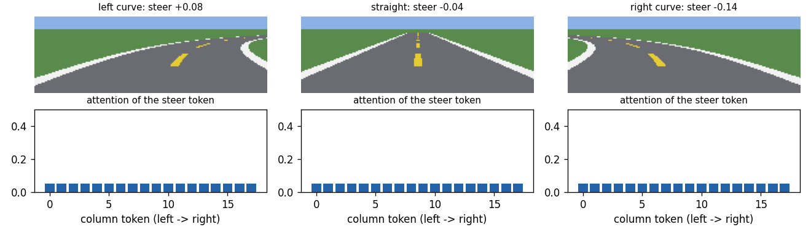

# 12주차 — 어텐션·언어 조건부 E2E·월드모델·VLA

202212305 김태윤 · 2026-11-18

이미지에서 조향값을 예측하던 E2E 정책을 확장하고, 각 방법의 장점과 한계를 살펴보는 실습입니다.
어텐션은 이미지 특징을 결합하는 방법을, 언어 조건은 주행 의도를 전달하는 방법을,
월드모델은 미래 상태를 예측해 행동을 고르는 방법을 다룹니다.
VLA 시연 로그에서는 추론 지연을 계산하고, 기존 정책의 L1~L5 평가로 개선 우선순위를 찾습니다.

## 자료와 결과 파일

| 파일 | 내용 |
|---|---|
| [Week12_demo.ipynb](Week12_demo.ipynb) | 제공된 원본 실습 노트북. 실행 출력이 저장되어 있지 않습니다. |
| [model_comparison.csv](model_comparison.csv) | 저장된 PilotNet·어텐션 ONNX를 다시 평가한 비교표 |
| [attention_map.png](attention_map.png) | 저장된 좌커브·직선·우커브 어텐션 그림 |
| [PilotNet.onnx](PilotNet.onnx) | 12주차 비교 실험의 PilotNet |
| [conv_스템_+_어텐션.onnx](conv_스템_+_어텐션.onnx) | 12주차 비교 실험의 어텐션 정책 |
| [self_eval.json](self_eval.json) | 기존 11주차 최종 정책의 L1~L5 점수. 원본 경로 기록을 유지했습니다. |
| [verification.json](verification.json) | 재평가 조건, 파일 해시, ONNX 검사 및 자가 평가 재확인 |

이 문서는 **저장된 결과의 재평가**, **코드 구조 분석**, **실습의 기대 경향**을 구분합니다.
이번 정리에서는 모델을 다시 학습하지 않았으며, 언어·월드모델 실험의 측정 수치는 원본 노트북에 남아 있지 않습니다.

## 이전 주차와의 연결

| 이전 내용 | 12주차 확장 |
|---|---|
| CNN으로 이미지→조향 예측 | CNN 특징을 어텐션으로 결합 |
| 8주차 CIL의 숫자 명령 | 문장 임베딩과 FiLM으로 주행 의도 입력 |
| 10주차 강화학습 | 동역학 모델을 학습하고 탐색으로 행동 선택 |
| 11주차 성능·지연 비교 | VLA 지연 예산과 L1~L5 약점 분석 |

## 1. 어텐션 — 어느 이미지 특징을 참고할까?

### 구조

```text
RGB 이미지 (3×66×200)
  → PilotNet의 CNN 특징 (64×1×18)
  → 가로 위치별 토큰 18개 (각 64차원)
  → 조향 정보를 모으는 CLS 토큰 추가
  → 위치 임베딩 + 단일 헤드 셀프 어텐션
  → CLS 특징에서 조향값 1개 예측
```

토큰은 이미지의 한 영역을 나타내는 특징 벡터입니다.
CLS 토큰은 다른 토큰의 정보를 모아 최종 조향 판단에 사용하며,
위치 임베딩은 가로 위치를 구별할 수 있게 합니다.
기존 PilotNet의 CNN 특징 추출기를 복사하되 조향 헤드는 새 어텐션 구조로 대체합니다.

어텐션 가중치는 다음과 같이 계산합니다.

$$
A=\operatorname{softmax}\left(\frac{QK^\top}{\sqrt{64}}\right)
$$

`Q`, `K`는 토큰의 관련성을 계산하고 `V`는 결합할 정보를 제공합니다.
코드의 `/ 8.0`은 특징 차원 64의 제곱근으로 나누는 부분입니다.
`h = t + A @ V`로 정보를 결합하고, 잔차 연결과 작은 피드포워드 신경망을 거쳐 조향을 출력합니다.
입력 전체를 바로 토큰화한 대형 ViT가 아니라 **CNN과 어텐션을 결합한 작은 정책**입니다.

### 저장된 모델의 재평가

공개 트랙 A/B/C, 평가 시드 0, ONNX Runtime CPU, 추론 배치 1로 평가했습니다.
검증 MAE는 기존 v2 데이터의 주행(run) 단위 분할(`val_frac=0.2`, `seed=0`) 후 검증 앞 400장에서 계산했습니다.

| 모델 | 검증 MAE ↓ | L1 기본 점수 ↑ | L2 외란 강화 점수 ↑ |
|---|---:|---:|---:|
| PilotNet | 0.0338 | 89.4 | 10.6 |
| CNN + 어텐션 | 0.0376 | 89.0 | 10.5 |

이번 저장 모델에서는 PilotNet이 소폭 앞섰고, 두 모델 모두 L2에서 성능이 크게 낮아졌습니다.
L1에서 두 모델은 완주했지만, L2에서는 세 트랙 모두 평가 종료 전에 이탈했습니다.
검증 이미지의 조향 오차가 작아도 외란 이후 복구를 포함한 폐루프 성능이 좋다는 보장은 없습니다.

실습은 두 모델에 같은 데이터와 3에폭을 사용합니다.
다만 PilotNet은 기존 조향 헤드까지 이어서 학습하고, 어텐션 모델은 새 헤드를 학습하므로
차이를 구조 하나의 효과로만 해석할 수 없습니다.
적은 데이터에서 CNN의 공간적 귀납 편향이 유리할 수 있지만,
이번 한 번의 비교로 어텐션의 일반적인 우열을 정할 수는 없습니다.



위는 입력 이미지와 조향 예측, 아래는 CLS가 가로 토큰 18개에 주는 어텐션 가중치입니다.
**저장된 그림에서는 세 장면 모두 가중치가 거의 균등합니다.**
따라서 이번 결과를 특정 차선에 집중한 사례로 해석하기는 어렵습니다.
또 토큰은 CNN의 넓은 수용 영역을 가지므로, 막대 하나가 원본 이미지의 얇은 세로 띠와 정확히 일치하지는 않습니다.
어텐션 가중치만으로 조향 판단의 인과적 원인을 확정할 수도 없습니다.

기존 어텐션 ONNX는 입력 배치가 가변으로 표시되지만,
`self.cls.expand(len(t), ...)`의 내보내기 과정에서 배치 1이 고정되어 큰 배치 추론이 실패하는 문제가 확인됐습니다.
이 폴더의 원본 모델과 재평가는 **배치 1**을 사용합니다.

## 2. 언어 조건부 E2E — 같은 도로에서 다른 의도 전달하기

### 명령과 목표

| 명령 예시 | 목표 측면 위치 `d` |
|---|---:|
| `keep left lane` | −0.25m |
| `stay center` | 0m |
| `keep right lane` | +0.25m |

명령별로 목표 위치가 다른 전문가의 주행 데이터를 수집합니다.
이 실험은 **도로 중심 기준 목표 오프셋을 유지하는 주행**이며, 교차로에서 좌·우회전하는 기능은 아닙니다.

### FiLM의 역할

```text
이미지 → CNN → 이미지 특징 f ────────────────────┐
문장 → 단어 임베딩의 평균 l → γ(l), β(l) ────────┤
                                                ↓
                           f ⊙ (1 + γ(l)) + β(l)
                                                ↓
                                            조향값
```

FiLM(Feature-wise Linear Modulation)은 언어 벡터로 이미지 특징의 각 성분을 확대·축소하고 이동시킵니다.
같은 이미지를 보더라도 목표가 왼쪽인지 중앙인지에 따라 조향을 달리하도록 학습하는 방식입니다.

### 일반화의 범위

학습 문장, 단어가 겹치는 새 문장, 학습하지 않은 어휘를 포함한 문장을 비교합니다.
평가 지표는 실제 주행의 평균 측면 위치와 목표 위치 사이 절대오차를 세 명령에 대해 평균한 값입니다.
평균 위치만으로는 좌우 진동이나 조기 이탈을 충분히 설명하지 못하므로, 이 지표를 전체 주행 품질과 동일시하면 안 됩니다.

- **알고 있는 단어의 재조합:** `left`, `right`, `middle`이 포함된 새 표현을 처리할 가능성이 있습니다.
- **미학습 어휘:** 어휘에 없는 단어는 모두 UNK 인덱스 0으로 바뀝니다.
- **어순:** 단어 임베딩을 평균내므로 단어 순서가 달라도 같은 벡터가 됩니다.

`hold your course`와 `go starboard`는 모든 단어가 UNK가 되어 같은 언어 벡터로 처리됩니다.
`go port side`에는 학습된 단어 `side`가 있지만, 방향을 나타내는 `port`는 학습하지 않았습니다.
따라서 사전학습 언어 모델의 의미 이해와는 구분해야 합니다.
사전학습은 더 넓은 어휘 지식을 활용할 기반을 제공하지만, 올바른 행동 연결까지 자동으로 보장하지는 않습니다.

노트북은 대체로 학습 문장보다 미학습 표현에서 오차가 커지는 경향을 기대합니다.
실제 순서는 학습 결과에 따라 달라질 수 있으며, 이번 폴더에는 해당 실험의 측정값이 없습니다.
학습의 `flip=False`는 이미지·조향만 좌우 반전했을 때 언어 명령과 라벨이 불일치하는 것을 막기 위한 설정입니다.

## 3. 미니 월드모델 — 미래를 예측하고 계획하기

### 정책 학습과의 차이

```text
직접 정책: 현재 이미지 → 신경망 → 조향
월드모델: 현재 상태 + 조향 후보 → 미래 상태 예측 → 비용 비교 → 조향 선택
```

상태 `d`는 도로 중심과의 거리, `ψ`는 도로 방향과 차량 방향의 차이,
`κ`는 도로 곡률, `a`는 조향 행동입니다.
전문가 조향에 큰 노이즈를 더해 전이 데이터를 수집하고 다음 변화량을 MLP로 학습합니다.

$$
f_\theta(d,\psi,\kappa,a)=(\Delta d,\Delta\psi)
$$

학습 목표는 `Y - X[:, :2]`이며, 다음 상태 자체보다 현재에서의 변화량을 예측하는 잔차 학습입니다.
일반 설정은 전이 4,500개, FAST 설정은 2,400개를 사용하고 300에폭 학습합니다.
출력되는 1스텝 오차는 **학습 데이터에서 측정한 오차**로, 별도 검증 오차가 아닙니다.

### 행동 선택과 계획 지평

`−1`부터 `1`까지 조향 후보 21개에 대해 미래 H스텝을 예측합니다.
비용은 매 스텝 중앙 편차와 조향 크기를 더하고, 마지막 위치 편차에는 추가 가중치를 줍니다.

$$
J(a)=\sum_{h=1}^{H}\left(|d_h|+0.02|a|\right)+5|d_H|
$$

후보 하나마다 **동일한 조향을 H스텝 동안 유지한다고 가정**하며, 모든 조향 시퀀스를 탐색하지는 않습니다.
현재 곡률도 H스텝 동안 일정하다고 가정합니다.
실제 주행에서는 선택한 행동을 한 번 적용하고 다음 상태에서 다시 계획합니다.

| 지평 | 살펴볼 효과 |
|---|---|
| H=1 | 단기 비용만 고려해 미래 효과를 놓칠 수 있음 |
| H=5~10 | 미래의 위치 변화를 반영한 조향 가능 |
| H=20 | 모델 오차, 곡률 고정 가정, 일정 조향 가정의 영향이 커질 수 있음 |

시뮬레이터의 시간 간격은 0.1초이므로 H=20은 2초입니다.
긴 지평이 반드시 더 좋은 결과를 내는 것은 아니며, H=5~10이 최적이라는 순서도 실제 측정으로 확인해야 합니다.
이번 폴더에는 지평별 실행 점수가 저장되어 있지 않습니다.

원본의 “다음 스텝의 d는 행동과 무관하다”는 설명은 현재 `tinytrack.py` 0.3.1과 다릅니다.
환경은 조향으로 `ψ`를 먼저 갱신한 다음 그 값으로 `d`를 갱신합니다.
예를 들어 `d=ψ=κ=0`에서 조향 `−1/0/+1`을 적용하면 다음 `d`는 약 `−0.00499/0/+0.00499m`입니다.
H=1은 행동이 위치에 영향을 주지 않아서가 아니라 **단기 비용만 고려하는 한계**로 이해해야 합니다.

이 계획기는 이미지 대신 **시뮬레이터의 실제 상태**를 입력받습니다.
이미지만 사용하는 E2E 정책과 점수를 비교할 때 정보 조건이 다르며, 실제 시스템에서는 상태 추정이 추가로 필요합니다.

## 4. VLA 시연 로그 — 언어 이해와 제어 지연

VLA는 Vision–Language–Action 모델로, 이미지와 언어를 입력받아 행동을 출력합니다.
이 셀은 OpenVLA를 직접 실행하지 않고, 노트북에 문자열로 기록된 시연 로그를 읽습니다.
아래 수치는 시연 로그·계산 예제이며 이번 컴퓨터에서 새로 측정한 성능이 아닙니다.

| 항목 | OpenVLA-7B 시연 기준 | PilotNet 계산 예제 |
|---|---:|---:|
| 프레임당 지연 | 약 230ms | 1ms |
| 처리율 | 약 4.35fps | 1,000fps |
| 0.5m/s에서 추론 중 이동 거리 | 11.5cm | 0.05cm |
| 33ms 제어 예산 대비 | 약 7배 | 약 0.03배 |

로그의 첫 추론은 1,884ms로 후속 추론보다 느리므로, 초기 지연과 반복 추론 지연도 구분해야 합니다.
이 사례에서는 큰 모델이 목표·명령을 정하고 작은 정책이 빠르게 조향하는 계층 구조를 생각할 수 있습니다.
230ms를 모든 VLA의 고정적인 속도나 역할 한계로 일반화할 수는 없습니다.
또 33ms는 이 셀에서 가정한 제어 예산이며, tinytrack의 시뮬레이션 스텝 100ms와는 별개입니다.

OpenVLA의 `bridge_orig` 예시는 로봇 조작용 7차원 행동을 출력합니다.
자동차의 조향값 한 개와 행동 공간이 다르므로, 문장을 바꾸자 벡터가 달라졌다는 사실만으로
자동차 좌회전 수행이나 올바른 주행 의미 이해가 검증되지는 않습니다.
출력이 0에 가깝다는 현상의 원인도 로그만으로 확정할 수 없습니다.
모델과 행동 인터페이스는 [OpenVLA 공식 저장소](https://github.com/openvla/openvla)를 참고했습니다.

## 5. 자가 평가 — 기존 정책의 약점 찾기

평가 대상은 새 어텐션 모델이 아니라 **11주차 최종 정책 [my_policy_v3.onnx](../week11/my_policy_v3.onnx)**입니다.
`self_eval.json`의 원본 정책 경로 `outputs/week11/my_policy_v3.onnx`는 수업 작업 폴더 기준입니다.
저장소에서는 위 상대 링크의 동일한 정책을 사용해 점수를 재확인했습니다.

| 레벨 | 조건 | 점수 |
|---|---|---:|
| L1 | 기본 | 89.5 |
| L2 | 외란 1.2배, 주기 40스텝 | 82.6 |
| L3 | 저조도 0.35, 센서 노이즈, 색 변화 | 87.0 |
| **L4** | **속도 1.3배, 외란 강화, 외관 변화** | **44.4** |
| L5 | 속도 1.5배 등 극한 조건, 보너스 | 26.4 |

공개 트랙 A/B/C, 평가 시드 0, 스타일 시드 7의 결과입니다.
점수는 완주율·도로 이탈·평균 중앙 편차를 반영하며 정확도(%)가 아닙니다.
노트북은 개선 대상 L2·L3·L4 중 최솟값을 고르므로, **가장 약한 레벨은 L4**입니다.
L5는 더 낮지만 공식 레벨이 아닌 보너스 구간입니다.

| 약점 | 개선 후보 |
|---|---|
| 외란 뒤 복구 | DAgger로 정책이 실제 방문한 상태에 전문가 라벨 추가 |
| 저조도·노이즈 | 밝기·색·센서 노이즈 랜덤화 |
| 고속 조건 | 속도 랜덤화, 해당 조건의 RL 미세조정 |

현재 정책에서는 고속이 포함된 L4 조건을 우선 개선할 수 있습니다.
다만 L4에는 외관·외란 변화도 함께 있으므로 점수 하락을 속도 하나의 영향으로 단정할 수 없습니다.
후속 실험에서는 속도만 바꾼 조건을 별도로 비교하고,
여러 시드와 미공개 트랙에서 개선 및 기존 성능 유지 여부를 확인해야 합니다.

## 실행 방법과 검증 범위

원본 노트북은 수업 작업 폴더에서 실행합니다.
다음 파일들은 이 저장소의 `week12/`에 모두 포함되어 있지 않으므로 수업 자료 또는 기존 실습 결과를 준비해야 합니다.

```text
수업 작업 폴더/
├── Week12_demo.ipynb
├── tinytrack.py                    # 0.3.1 이상
├── models/base_pilotnet.pt         # 기존 torch 정책이 없을 때
└── outputs/
    ├── week07/my_dataset_v2.npz
    ├── week07/my_policy_v2.pt
    └── week11/my_policy_v3.onnx
```

필요 패키지는 `numpy`, `matplotlib`, `pandas`, `torch`, `onnx`, `onnxruntime`입니다.
노트북은 v2 자료가 없으면 v1 또는 즉석 생성으로 대체합니다.
실행 결과는 로컬 `outputs/week12/`, Colab에서는 Drive의 `AIApp/week12/`에 저장합니다.
`NB_FAST=1`로 FAST 설정을 선택할 수 있지만, 일부 학습량만 줄이는 설정이므로 실행 시간은 환경에 따라 다릅니다.

이번 정리에서 확인한 범위는 원본 노트북의 구문,
두 비교 ONNX의 구조·배치 1 추론·검증 MAE·L1/L2 점수,
기존 최종 정책의 L1~L5 점수 및 저장 결과와의 일치 여부입니다.
언어·월드모델의 학습 재실행, 전체 노트북 실행, 여러 시드의 일반화 검증은 수행하지 않았습니다.

## 해석 5줄

1. 저장된 PilotNet은 MAE 0.0338·L1 89.4로 어텐션 모델의 0.0376·89.0보다 소폭 앞섰으며, 구조와 초기화 조건을 고려하면 어텐션의 우위를 확인한 결과는 아니다.
2. 어텐션 그림은 세 장면 모두 거의 균등하므로 특정 차선을 선택적으로 참고했다고 해석할 근거가 부족하다.
3. 작은 언어 조건부 모델은 학습 어휘의 재조합을 다루지만, UNK와 평균 임베딩 때문에 미학습 어휘와 어순을 구별하는 데 한계가 있다.
4. 월드모델은 상태 변화 예측과 탐색으로 행동을 고르며, 긴 지평에는 예측 오차와 일정 곡률·조향 가정의 영향이 누적될 수 있다.
5. VLA 시연의 지연은 계층 구조를 고려하게 하며, 현재 최종 정책은 L4 44.4점이 가장 약해 속도 조건을 분리한 평가와 속도 랜덤화·RL을 개선 후보로 삼을 수 있다.
